# SwarmGuard

**Drone swarm GPS spoofing detection, recovery and digital forensics, as a software simulation.**

SwarmGuard simulates a swarm of drones flying in formation over Pune. It adds false offsets to the
GPS positions the drones *report*, then checks whether independent measurements expose the lie.
Three detectors (plus one experimental ML detector) run side by side on identical data. Their
evidence is fused with uncertainty kept visible, true positions are recovered, performance is
measured statistically over many seeds, and every incident becomes a tamper-evident,
Ed25519-signed evidence package that can be verified later.

> **Simulation only.** SwarmGuard generates no radio signals, touches no real drone or receiver, and
> contains no attack tooling for real systems. A "spoof" here is arithmetic on simulated numbers.
> Every number it shows is a *simulation result*.

Built by a first-year B.Tech CSE (Cybersecurity & Forensics) team at MIT-WPU, Pune.

---

## The central idea

No single detector covers every attack. The platform shows **where each one succeeds and where it
is blind**.

**Detector A (relative geometry)** compares GPS-derived distances between drones with radio ranges
measured independently. It catches a single spoofed drone. It is **mathematically blind** to a
swarm-wide rigid shift, because a common offset `D` cancels out of every distance:

```
(g_i + D) - (g_j + D) = g_i - g_j
```

A rigid rotation keeps every length too. The RigidShift work (Park & Yoo) formalised this blind
spot. **Detector B (motion)** and **Detector C (anchors)** see what A cannot. Running all of them
on the same flight makes the blind spot visible:

| What you see in the app | Meaning |
|---|---|
| A silent, B alarm, C alarm | Coordinated swarm shift suspected |
| A alarm on one drone, B alarm on the same drone | A single drone's GPS is inconsistent |
| B alarm only, C no evidence | Motion inconsistency on unanchored drones |

---

## Architecture

```
                 config.py (SimConfig, AttackConfig, DetectorConfig)
                                   |
   simulation/  formation -> swarm (closed-loop control) -> sensors
   attacks/     gps_attacks (offsets on REPORTED GPS) + scenarios (presets)
                                   |
                     Frame = truth + ObservedFrame
                    /                              \
         ObservedFrame ONLY (rule R1)          truth (evaluation only)
                    |                                   |
   detection/  A geometry | B motion | C anchors   analysis/metrics.py
               (D experimental ML, opt-in)        analysis/propagation.py
                    |
               fusion.py (Dempster-Shafer)
                    |
   recovery/   MDS + RANSAC/Kabsch alignment, multilateration
                    |
   analysis/   calibration, experiments (sweeps), evasion search, propagation
                    |
   forensics/  incident -> hashing -> Ed25519 signatures -> evidence package -> explainer
   database/   SQLite storage + chain of custody
   reports/    PDF report (matplotlib figures, reportlab)
                    |
   app.py + views/ + ui/   Streamlit "Ground Truth" web app       cli.py   command line
```

`core/schema.py` defines the data contract. Detectors, fusion and recovery accept only an
`ObservedFrame`, a dataclass with no truth fields. Passing a `Frame` raises `TypeError`.

---

## Quick start (Windows, PowerShell, Python 3.11)

```powershell
git clone <your-repo-url> SwarmGuard
cd SwarmGuard
python -m venv .venv
.venv\Scripts\pip install -r requirements.txt
.venv\Scripts\streamlit run app.py
```

The app opens at http://localhost:8501. Press **Run the Pune light show** on Home for a full
example run.

### Command line examples

```powershell
.venv\Scripts\python cli.py list-scenarios
.venv\Scripts\python cli.py run --scenario single_hijack --seed 3 --plot
.venv\Scripts\python cli.py detect --scenario rigid_swarm_shift --seed 5000
.venv\Scripts\python cli.py calibrate --seeds 200 --target 0.01
.venv\Scripts\python cli.py sweep --param magnitude --scenario single_hijack --seeds 50 --workers 4
.venv\Scripts\python cli.py evasion --scenario slow_drift --seeds 40
.venv\Scripts\python cli.py propagation --scenario clean_baseline --magnitude 6
.venv\Scripts\python cli.py investigate --scenario light_show_pune --seed 5001
.venv\Scripts\python cli.py verify data\packages\<incident-id>.zip
.venv\Scripts\python cli.py tamper-test data\packages\<incident-id> --file detections.csv
.venv\Scripts\python cli.py train-ml --runs 300
.venv\Scripts\python cli.py detect --scenario single_hijack --ml
```

### Tests

```powershell
.venv\Scripts\python -m pytest -q
```

There is one test file per module (`tests/test_schema.py`, `test_detector_a.py`, ... `test_ml.py`),
plus the per-phase suites `tests/test_phase1.py` ... `test_phase5.py` and `test_phase7.py` (maps,
design motifs and a sweep for retired design elements). After adding tests, run
`.venv\Scripts\python cli.py count-tests` so the Home page shows the new count.

---

## Scenario catalogue

Expected outcomes come straight from the scenario presets (`attacks/scenarios.py`).
*detect* = should alarm, *blind* = mathematically cannot see it, *partial* = depends on anchors or
persistence.

| Key | Title | Attack type | A | B | C |
|---|---|---|---|---|---|
| `clean_baseline` | Clean baseline | none | - | - | - |
| `single_hijack` | Single drone hijack | constant_offset | detect | detect | partial |
| `slow_drift` | Slow single-drone drift | gradual_drift | detect | detect | partial |
| `coordinated_pair` | Coordinated pair | multi_drone | detect | detect | partial |
| `rigid_swarm_shift` | Rigid swarm shift | swarm_wide | blind | detect | detect |
| `rigid_swarm_drift` | Rigid swarm drift | swarm_wide | blind | detect | detect |
| `rigid_rotation` | Rigid rotation | rigid_rotation | blind | partial | partial |
| `faulty_anchor_shift` | Rigid shift with faulty anchors | swarm_wide | blind | detect | partial |
| `intermittent_pulses` | Intermittent pulses | intermittent | detect | detect | partial |
| `manoeuvre_only` | Legitimate manoeuvres only | none | - | - | - |
| `light_show_pune` | Pune light show | swarm_wide | blind | detect | detect |

`clean_baseline` and `manoeuvre_only` contain no attack. Any alarm in them is a false alarm.

---

## How each detector works

**A: relative geometry** (`detection/detector_a_geometry.py`)
```
R_ij    = | ||g_i - g_j|| - r_ij |            GPS distance vs radio range
score_i = #{j : R_ij > tau_a} / #{valid j}    share of partners that disagree
flag_i  = score_i > 0.5                       majority vote, then 3-of-5 persistence
```
With fewer than 2 valid pairs the result is NO_EVIDENCE.

**B: motion consistency** (`detection/detector_b_motion.py`)
A Kalman filter per drone, in metres, driven by the drone's own velocity sensor (fix F7).
```
predict:  x- = x + u*dt,  P- = P + Q
update:   y = z - x-,  S = P- + R,  NIS = y' S^-1 y  ~ chi2(2)
CUSUM:    S_t = max(0, S_{t-1} + NIS_t - (2 + k)),  alarm if S_t > h
```
NIS catches jumps. CUSUM accumulates small surprises, so slow drifts, including swarm-wide ones,
build up until they cross `h`. Gated fixes are not absorbed, so the evidence persists.

**C: absolute anchors** (`detection/detector_c_anchor.py`)
```
r_i = ||g_i - a_i||     only for drones with a trusted absolute fix
swarm score = median(r_i)   robust to one faulty anchor
```
With zero anchors the result is NO_EVIDENCE, never a clean 0 (fix F8).

**D: experimental ML** (`detection/detector_d_ml.py`)
A Random Forest (200 trees, depth 12, balanced classes) on 11 features per drone per step: NIS,
CUSUM, 10-step mean NIS, A's vote fraction, A's largest pair residual, C's residual (-1 if
unanchored), has-anchor, GPS speed, |GPS velocity - velocity sensor|, GPS acceleration and
heading change.
```
P_i = mean over trees of p_t(attacked | x_i),   raw flag = P_i > 0.5,   then 3-of-5 persistence
```
**It is experimental.** It learns only from this simulator, so it can be no more realistic than
the simulation. Its inputs *are* A, B and C, so it is not an independent witness, and it is kept
**out of fusion**. Its main value is the feature-importance chart. Turn it on with the
*Experimental ML detector* toggle in the Detection and Experiments views (train it first with
`cli.py train-ml`, or with the in-app *Train quick model* button).

**Fusion** (`detection/fusion.py`): each detector's score becomes masses
(attack, normal, uncertain), discounted by a reliability factor. Detectors with NO_EVIDENCE give
(0, 0, 1). Dempster's rule combines them:
```
K = m1a*m2n + m1n*m2a,   attack = (m1a*m2a + m1a*m2u + m1u*m2a) / (1 - K)
```

**Recovery** (`recovery/`): classical MDS rebuilds the formation from radio ranges.
RANSAC + Kabsch (with a mirror check) aligns it onto anchor fixes and rejects faulty anchors.
Multilateration repairs single drones from trusted, never-flagged neighbours (fix F1).

---

## Calibration and evaluation methodology

| Seed range | Used for |
|---|---|
| 1000 - 4999 | Calibration of thresholds (clean flights; odd seeds fly legitimate manoeuvres) |
| 5000 + | Evaluation: sweeps, evasion search, tests, CLI examples |
| 100000 + | Training runs for the experimental ML detector |

The ranges never overlap. Tuning and testing on the same random flights would make results look
better than they are.

- **Target false-alarm rate:** 1 % of clean flights per detector (`calibrate --target 0.01`).
  Thresholds are the smallest values that meet the target on 200 calibration flights. They are
  saved to `data/calibration/` and only used when explicitly loaded (fix F3).
- **Why 200 seeds:** choosing "the smallest threshold that meets the target" on a small sample is
  optimistic. In our own measurement on 20 s flights, calibrating Detector C on 60 seeds picked a
  threshold that alarmed on 14 % of new clean flights; 200 seeds picked one that alarmed on 3 %.
  `tests/test_calibration.py` checks the calibrated rate on 50 fresh evaluation flights against the
  target with a Wilson interval.
- **Rates** are reported with 95 % Wilson intervals. Detection delay is measured from the true
  onset (evaluation only).
- **ML evaluation** uses a train/test split *by run* (`GroupShuffleSplit`, fix F6): no flight
  contributes rows to both sets.

### Results (fill these from your own runs; no numbers are invented here)

Detection rate over evaluation seeds (Wilson 95 % CI). Simulation result.

| Scenario | Seeds | A | B | C | Fused F |
|---|---|---|---|---|---|
| single_hijack | | | | | |
| slow_drift | | | | | |
| coordinated_pair | | | | | |
| rigid_swarm_shift | | | | | |
| rigid_swarm_drift | | | | | |
| rigid_rotation | | | | | |
| faulty_anchor_shift | | | | | |
| intermittent_pulses | | | | | |
| light_show_pune | | | | | |

False-alarm rate on clean flights. Simulation result.

| Scenario | Seeds | A | B | C | Fused F |
|---|---|---|---|---|---|
| clean_baseline | | | | | |
| manoeuvre_only | | | | | |

Experimental ML detector, held-out test runs (from `cli.py train-ml`). Simulation result.

| Runs | Accuracy | Precision | Recall | F1 | ROC-AUC | Top 3 features |
|---|---|---|---|---|---|---|
| | | | | | | |

---

## Fixes over prior work (F1 - F8)

| Fix | What | Where |
|---|---|---|
| F1 | Multilateration never uses already-flagged neighbours | `recovery/multilateration.py` (`trusted_neighbours`) |
| F2 | Range noise is actually stored in the range matrix | `simulation/sensors.py` (`SensorSuite.ranges`) |
| F3 | Thresholds are never silently overwritten | `analysis/calibration.py` (`load_or_default` logs its choice) |
| F4 | Robust RANSAC alignment is the default in scoring | `recovery/mds_alignment.py` (`ransac_align`) |
| F5 | ML labels stay 1 for the whole attack window | `attacks/gps_attacks.py` (labels), `detection/detector_d_ml.py` |
| F6 | ML train/test split by run, never by row | `detection/detector_d_ml.py` (`group_split`) |
| F7 | Kalman filter works in metres and uses the velocity input | `detection/detector_b_motion.py` |
| F8 | Detector C returns NO_EVIDENCE with zero anchors, not a "clean" 0 | `detection/detector_c_anchor.py` |

Each fix has a test (`tests/test_sensors.py`, `test_detector_c.py`, `test_recovery.py`,
`test_attacks.py`, `test_ml.py`, `test_phase2.py`).

---

## Credits (concepts only; all code written independently)

| Work | Authors | Concepts used |
|---|---|---|
| RigidShift | Minseok Park, Joon Soo Yoo | rigid-covert GNSS spoofing, anchor consensus, MDS + rigid alignment |
| SwarmFuzz (IEEE/IFIP DSN 2023) | Elaine Yao, Pritam Dash, Karthik Pattabiraman | swarm propagation vulnerabilities, graph + PageRank seeding |
| SwarmRaft | Kapel Dev, Yash Madhwal, Sofia Shevelo, Pavel Osinenko, Yury Yanovich | neighbour voting, multilateration recovery |
| GNSS Guardian | GitHub user szyraf | feature engineering, Random Forest, Streamlit dashboard |
| UAV Intelligence Fusion System | Arzoo Tiwary | Dempster-Shafer fusion, template reports, modular pipeline |
| ZYRNAV Resilience Lab | Chris Matheus Rozario | scenario presets, decision inspector UI pattern |

**Interface design.** The app uses SwarmGuard's own original "Ground Truth" design system: survey
maps (sand paper, olive contours, coordinate rulers), forensic case files (case numbers, folder
tabs, rubber stamps, hash ribbons) and amber instrument displays (the radar scope). It has a
general influence from neo-brutalist web design (outlined shapes, hard shadows); no other
product's look, imagery or assets are used.

**Fonts.** Fraunces, IBM Plex Sans and IBM Plex Mono, all under the SIL Open Font License
(licence texts in `assets/fonts/`). The TTF files there are used by the PDF report; the web app
loads the same fonts from Google Fonts.

---

## Limitations

- **2D only:** a flat local East-North frame in metres; no altitude.
- **Simplified kinematics:** point-mass drones with proportional velocity control; no aerodynamics,
  wind or motor dynamics.
- **Gaussian noise:** independent Gaussian errors on every sensor; no multipath, outliers or
  correlated errors.
- **Independent channels assumed unspoofed:** radio ranging, velocity sensors and anchors are
  assumed untouched by the GPS spoof. A real attacker who also corrupts them would defeat the
  corresponding detector.
- **Simulation only:** every number is a simulation result about this model, not a measurement
  of real drones.
- **ML is experimental:** Detector D learns only the simulator's attacks and noise, and re-uses
  A, B and C as inputs.
- **Forensics:** a valid signature proves the evidence is unchanged since signing. It does not
  prove the telemetry was genuine. The platform never identifies an attacker.
- No detection means "no anomaly detected", never "safe".

---

## Module ownership (for the viva)

| Module / files | Owner | Can explain |
|---|---|---|
| `core/`, `config.py` | | |
| `simulation/` | | |
| `attacks/` | | |
| `detection/detector_a_geometry.py` | | |
| `detection/detector_b_motion.py` | | |
| `detection/detector_c_anchor.py` | | |
| `detection/detector_d_ml.py` | | |
| `detection/fusion.py` | | |
| `recovery/` | | |
| `analysis/` | | |
| `forensics/`, `database/` | | |
| `reports/` | | |
| `ui/`, `views/`, `assets/`, `app.py` | | |
| `cli.py`, `tests/` | | |

---

## Deployment to Streamlit Community Cloud

1. Push the repository to GitHub. `data/`, `keys/` and `.venv/` are in `.gitignore` and are
   **never committed**.
2. On https://share.streamlit.io choose **New app**, pick the repository and branch `main`, and set
   the **entry point to `app.py`**. Choose Python 3.11. Dependencies install from
   `requirements.txt`.
3. **Keys:** the Ed25519 signing key pair is generated automatically on first use (the first
   evidence package) in `keys/`. On Streamlit Cloud this storage is temporary, so packages signed
   there should be verified there or with the downloaded public key. Set the environment variable
   `SWARMGUARD_KEY_PASS` (as a Streamlit secret) to encrypt the private key.
4. **Calibration and ML model:** a fresh deployment has neither. Detectors use the analytical
   default thresholds (the choice is logged, fix F3; run calibration from the Experiments view to
   measure them), and the experimental ML views offer a
   *Train quick model* button.
5. **Offline demos:** the Swarm Simulator has an **Offline map** toggle that draws the swarm on a
   plain metre grid instead of the carto-darkmatter map tiles, for demos without internet.

Data locations can be redirected with environment variables: `SWARMGUARD_DB`, `SWARMGUARD_KEYS`,
`SWARMGUARD_PACKAGES`, `SWARMGUARD_MODELS`.

---

## Screenshots

| | |
|---|---|
| 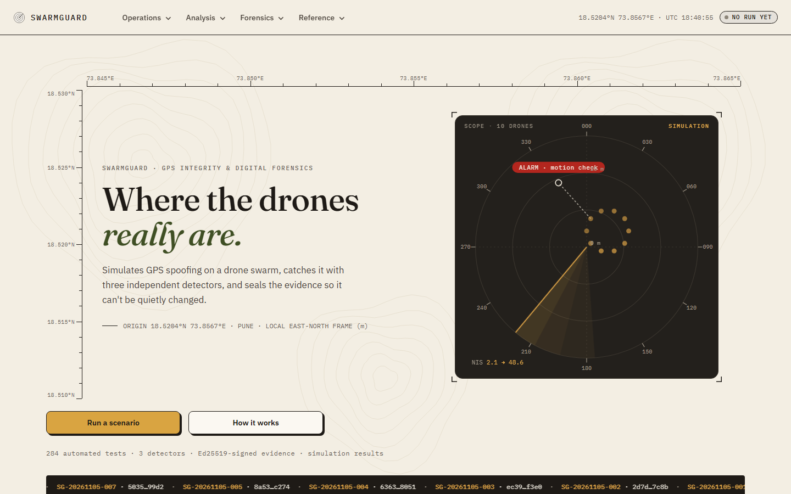 | 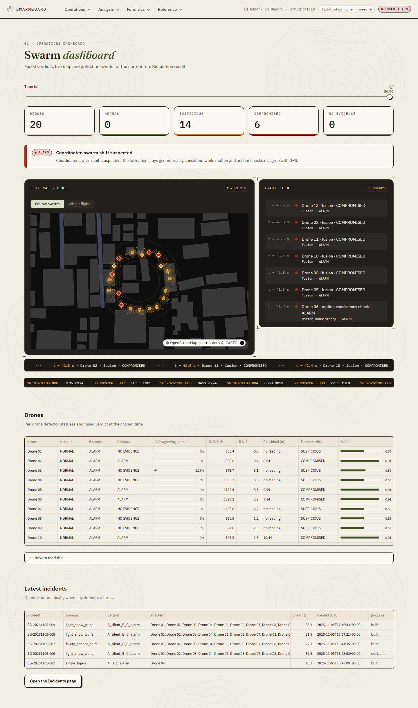 |
| 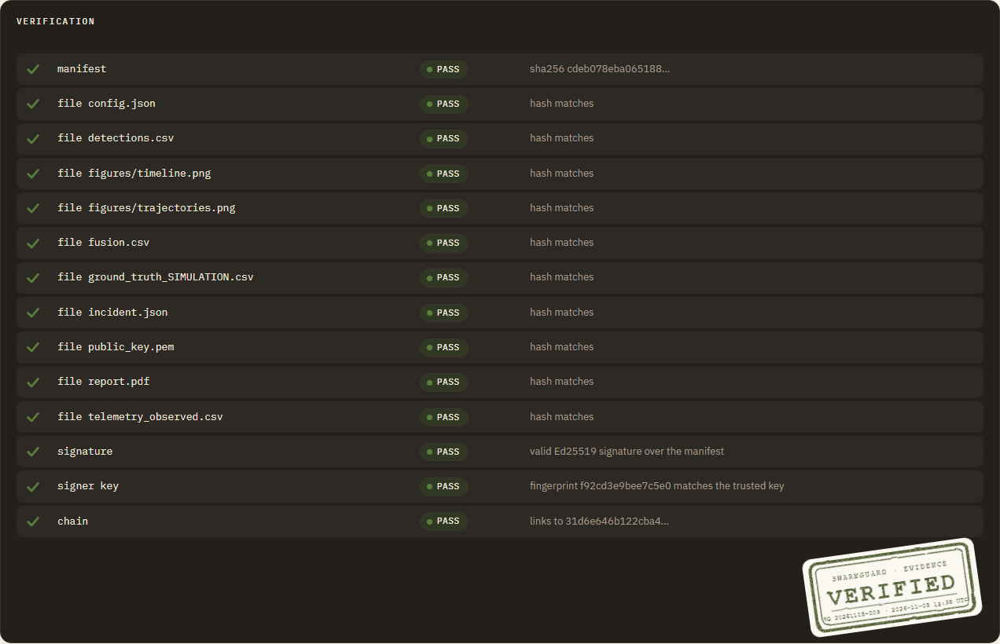 | 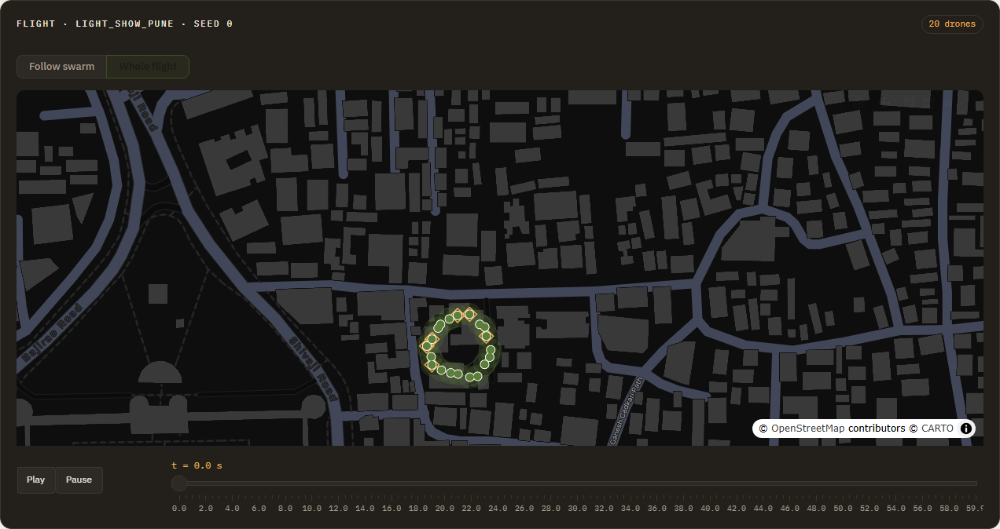 |
| 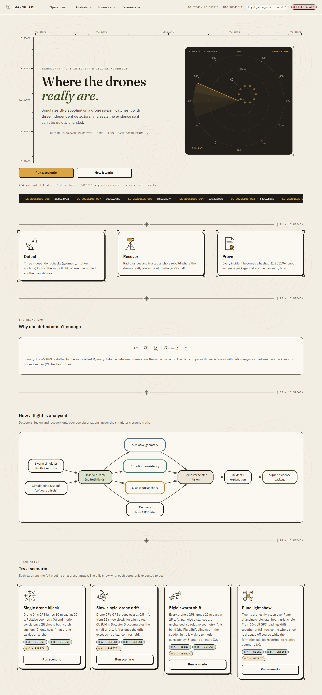 | 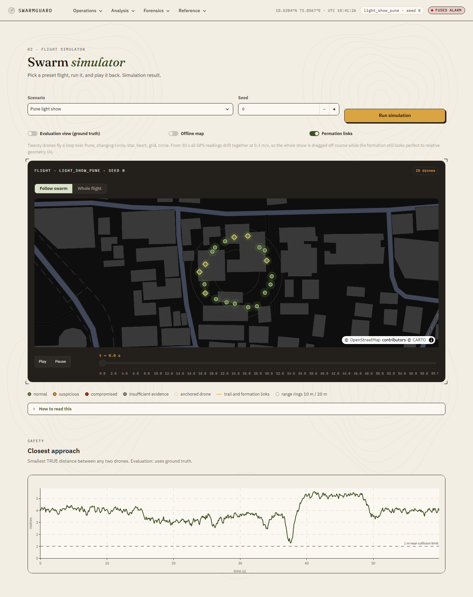 |
| 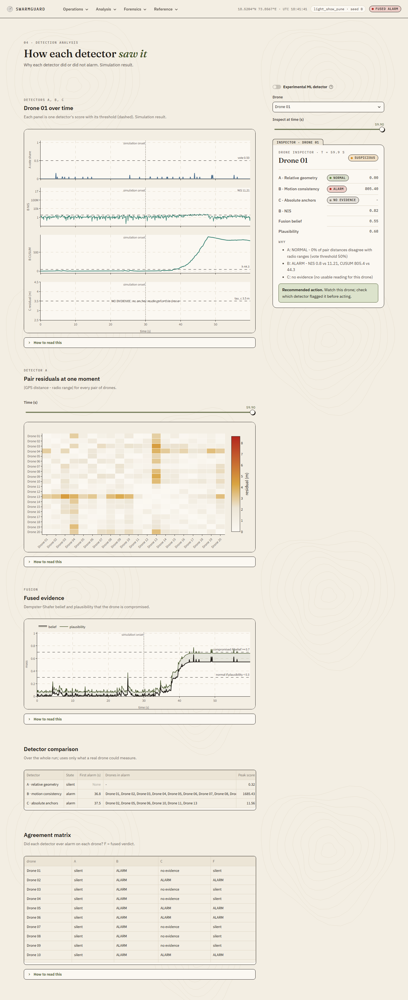 | 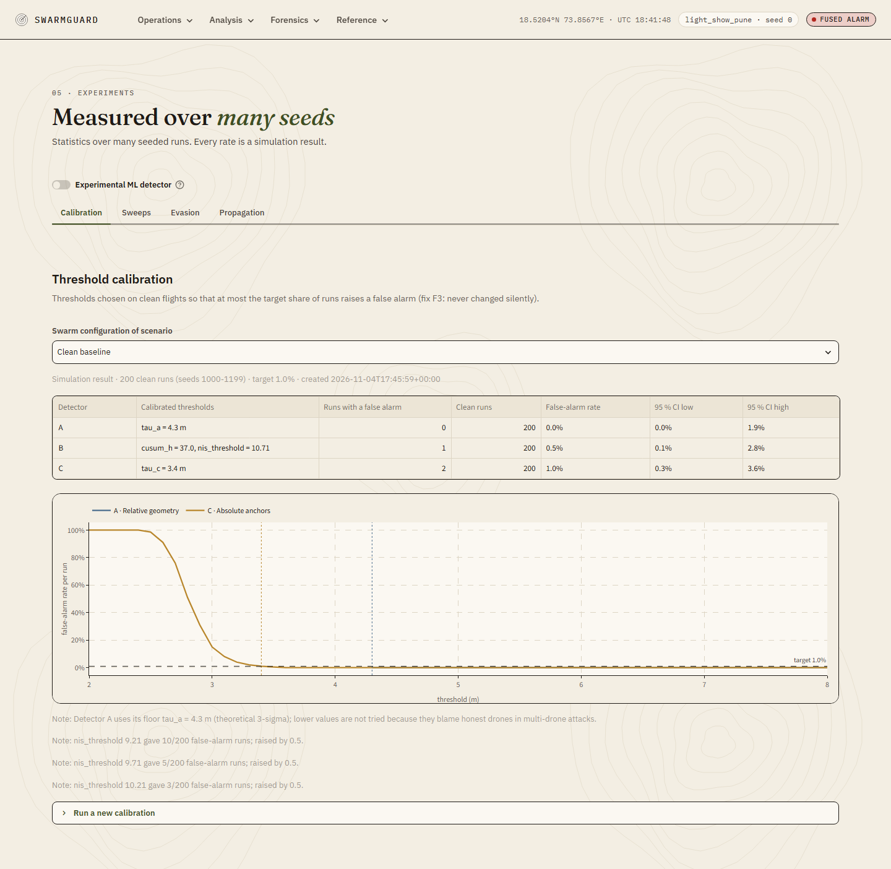 |
| 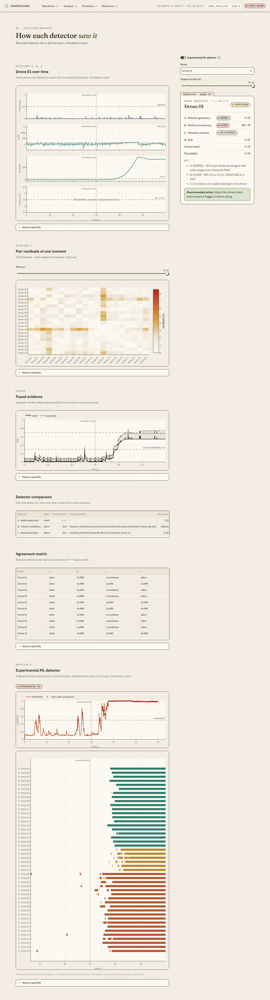 | 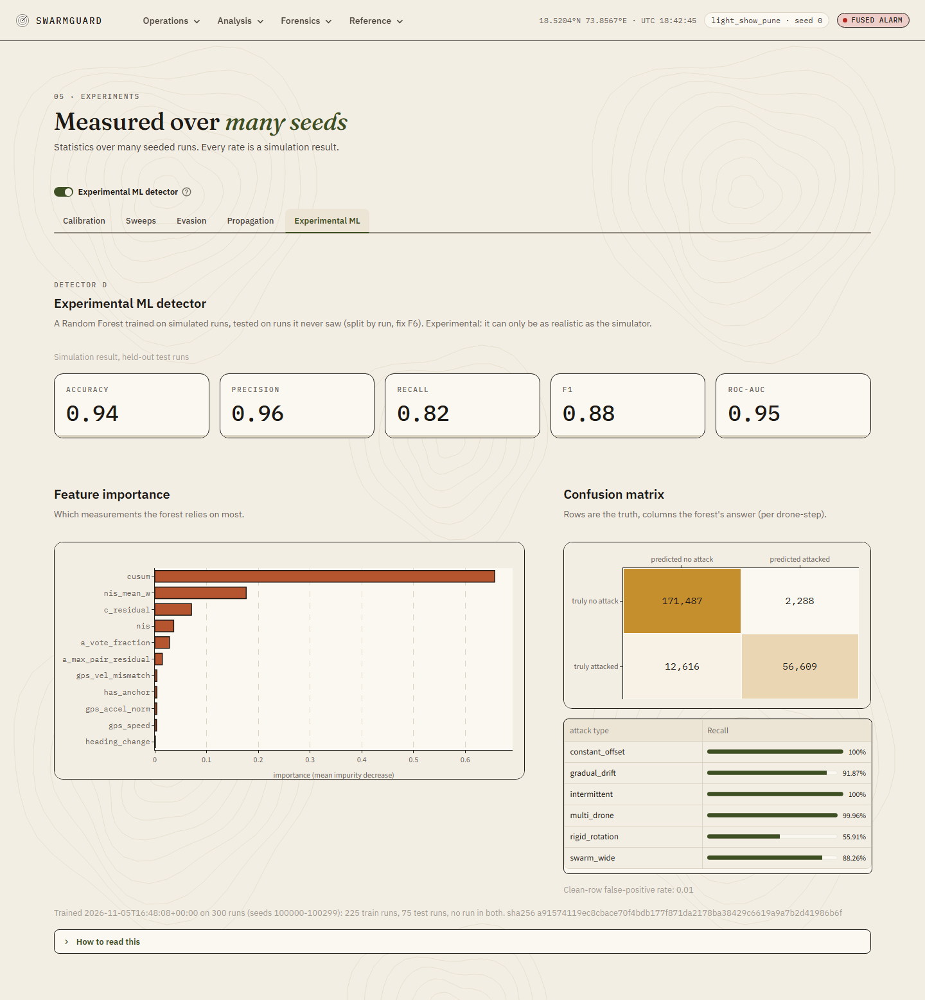 |
| 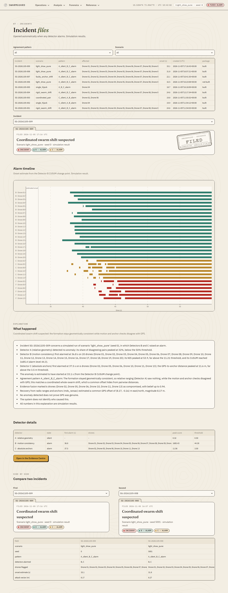 | 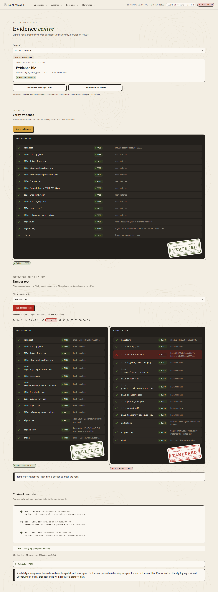 |
| 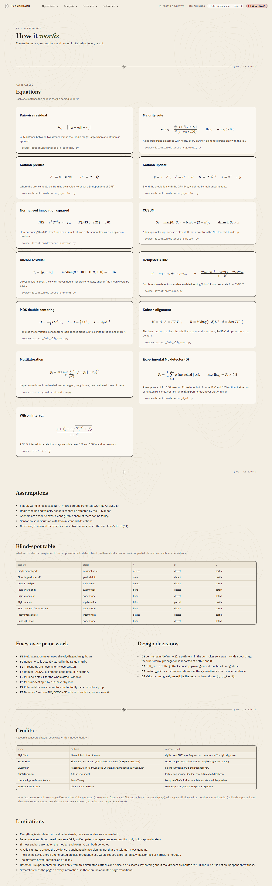 | 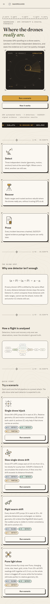 |

### Using the maps

Drag to pan, scroll to zoom, and use "Reset view" in the map's toolbar to return. The
**Camera** control above each map switches between **Follow swarm** (the view stays centred on the
swarm's GPS-reported centre) and **Whole flight** (one fixed view showing every position of the
run). On the Swarm Simulator, switching camera restarts the playback at t = 0, because Plotly plays
the animation inside the browser and Streamlit never learns which frame was showing; on the
Dashboard the time slider keeps its value.

Beginner-level explanations of every file, with likely viva questions, are in `docs/notes/`.
